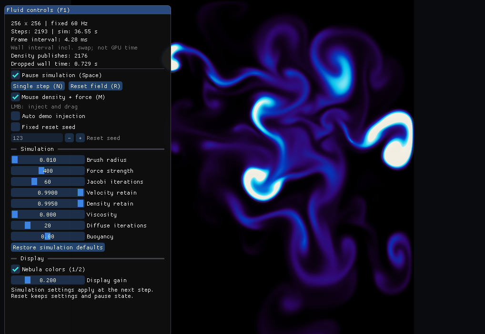
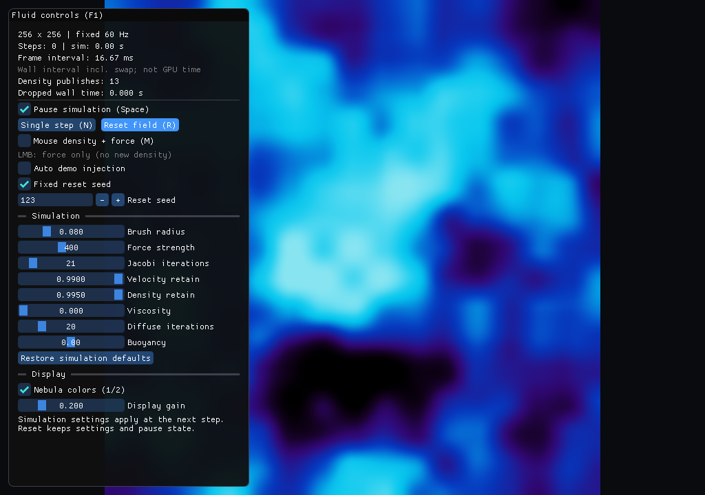

# CUDA Fluid

项目地址：[How-to-express-something/Fluid](https://github.com/How-to-express-something/Fluid)

使用 C++17、CUDA 和 OpenGL 3.3 实现的实时二维流体演示。CUDA 负责求解，OpenGL 负责显示，Dear ImGui 提供参数面板。

## 效果展示



<details>
<summary>查看参数面板截图</summary>



</details>

## 功能与技术点

- MAC 交错网格；速度/密度平流、黏性扩散、散度、Jacobi 压力求解与投影。
- 将固定压力迭代捕获为 CUDA Graph，初始化后复用；迭代次数改变或网格重建时更新资源。
- CUDA–OpenGL 互操作：注册 R32F 纹理，Map → GPU 内复制 → Unmap；正常显示不回读 CPU，包含一次 GPU 内复制。
- 60 Hz 固定模拟步长，暂停、单步、重置、鼠标施力和自动演示。
- 运行时参数面板；隔离 UI/画布输入，支持仅施力、固定重置 seed 和显示设置。
- solver/pipeline 基准、CPU/CUDA/GL 计时、A/B 报告比较和自动回归检查。

## 构建

已验证：Windows、Visual Studio 2022（MSVC 14.38）、CUDA 12.6、RTX 4070 Laptop（架构 89）。需要 CMake 3.24+、Python 3 和 Jinja2。其他工具链或 GPU 请调整参数。

```powershell
python -m pip install Jinja2
cmake -S . -B build/opengl -G "Visual Studio 17 2022" -A x64 -T version=14.38 -DCMAKE_CUDA_ARCHITECTURES=89
cmake --build build/opengl --config Release --parallel 4
.\build\opengl\Release\Fluid.exe
```

首次配置需要网络下载固定版本和 SHA-256 的 GLFW 3.4、GLAD 2.0.8、Dear ImGui 1.91.9b。CUDA 与 OpenGL 必须使用关联的 NVIDIA GPU。CMake 默认启用测试；`-DBUILD_TESTING=OFF` 可关闭 CTest 目标。

## 操作

| 操作 | 行为 |
| --- | --- |
| 左键/拖动 | 注入密度并施力 |
| M | 切换鼠标密度注入；关闭后仍可施力 |
| Space / N | 暂停/继续；暂停时单步 |
| R | 重置场，保留当前参数及暂停状态 |
| 1 / 2 | 灰度/彩色 |
| F1 | 显示/隐藏面板 |
| Esc | 应用获得键盘输入时退出 |

面板可设置 Jacobi 次数、耗散、黏度、浮力、笔刷、显示增益等。模拟设置在下一模拟步生效，显示设置不修改场；固定 seed 只影响后续重置。操作 UI 的鼠标手势不会向场注入，离开 UI 后需松开再按下；编辑 UI 时不触发应用快捷键，点击画布后恢复。自动演示有独立开关，不受鼠标密度开关控制。

其他模式：`--demo` 自动注入，`--preview` 约 3 秒预览，`--help` 查看参数。

## 验证

```powershell
ctest --test-dir build/opengl -C Release --output-on-failure
compute-sanitizer --tool memcheck --leak-check full --error-exitcode 1 build/opengl/Release/Fluid.exe --panel-test
```

六项 CTest 覆盖数值、真实 CUDA–GL 像素/纹理、面板控件、输入策略、固定时间步和基准报告。面板检查使用真实 ImGui 后端与合成事件，并运行实际预览主循环；它不替代物理设备、多显示器或所有操作组合的人工测试。

## 性能实验

在同一 RTX 4070 Laptop、固定 60 次压力迭代的历史交替复测中：

| 网格 | solver 加速比 | pipeline 加速比 |
| --- | ---: | ---: |
| 256² | 3.28× | 1.47× |
| 512² | 2.23× | 1.36× |
| 1024² | 1.11× | 未显示稳定收益 |

这是指定工作量的实测比值，不是游戏 FPS。数字对应当时的 A/B 构建，不是当前面板开销的测量；单机、未锁频等限制见 [测试口径和复现方法](docs/benchmark.md)。公开仓库只保留精简汇总与图表，不包含原始 profiler、CSV 大文件、机器日志或程序包。

## 结构与数据流

```text
source/       FluidSim、GPU 缓冲区、核函数与压力 Graph
graphics/     Application、Renderer、面板、输入策略、基准和测试
scripts/      基准比较、交替复测、绘图及统计契约测试
docs/         架构、测试口径、普通启动对照补丁和精简结果
assets/       一张实际截图、两张性能图
```

详细说明：[CPU/GPU 数据流与资源管理](docs/architecture.md)、[性能实验](docs/benchmark.md)。构建产物、依赖缓存、实验原始数据和学习笔记不纳入发布。

第三方依赖：[GLFW](https://github.com/glfw/glfw)、[GLAD](https://github.com/Dav1dde/glad)、[Dear ImGui](https://github.com/ocornut/imgui)。依赖源码及许可随 CMake 下载，未复制到本仓库；后续分发二进制应保留相应依赖许可。
