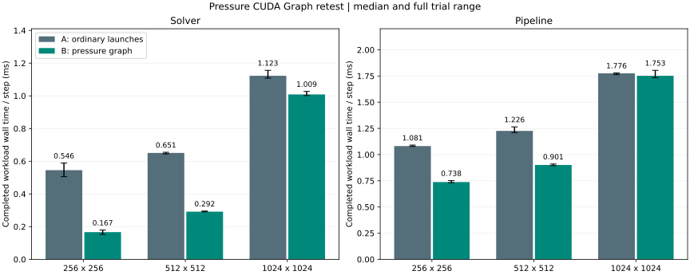
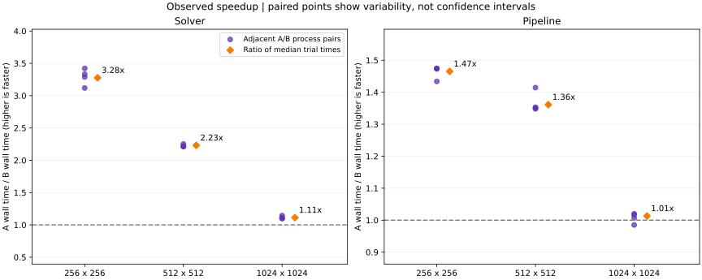

# 压力 Graph 的测试口径与复现

测试口径约定测量对象、固定条件、计时边界、重复顺序、统计方法与结论范围。

## 历史实验记录

2026-11-09 在 i7-14700HX / RTX 4070 Laptop、CUDA 12.6、MSVC 14.38、Release、架构 89 上进行交替复测。A 不含 Graph 资源，pressure 包装函数不带 stream 参数；B 缓存压力 Graph。两边的差分算法、计算量和其他设置相同。

| 条件 | 约定 |
| --- | --- |
| 模式 | solver 仅求解；pipeline 包含求解、发布、绘制与 SwapBuffers |
| 网格 | 256²、512²、1024²，分别比较 |
| 计算 | Jacobi=60、viscosity=0、dt=1/60、seed=123、相同脚本输入 |
| 显示 | 隐藏窗口、1024×720 framebuffer、彩色、请求 VSync=0 |
| 预热 | 每个进程 240 步，计时前同步；不含在正式测量内 |
| 测量 | pilot 估算约 3 秒目标，双方使用相同固定步数；实际约 2.85–11.48 秒 |
| 重复 | ABBA、BAAB，共 8 个独立进程，每边 4 次；在途计时槽位=4 |
| 主指标 | 完成固定工作量并排空计时结果的墙钟时间 |
| 汇总 | 跨进程均值的中位数；范围为最小/最大值，不是置信区间 |

排除初始化、分配、Graph 实例化、预热、最终场回读和文件写盘。`step_cpu` 只表示 CPU 调用时间；CUDA event 区间可能含提交间隙，不是纯 kernel 活动时间。CPU/GPU 阶段会重叠，不能相加。吞吐不是实际游戏 FPS 或输入延迟。

| 模式 | 网格 | 测量步数/进程 | A ms/步 | B ms/步 | 中位耗时比 A/B | 相邻配对范围 |
| --- | --- | ---: | ---: | ---: | ---: | --- |
| solver | 256² | 19,491 | 0.5456 | 0.1665 | 3.277× | 3.120–3.422× |
| pipeline | 256² | 3,902 | 1.0812 | 0.7379 | 1.465× | 1.434–1.475× |
| solver | 512² | 10,066 | 0.6506 | 0.2916 | 2.231× | 2.211–2.252× |
| pipeline | 512² | 3,338 | 1.2264 | 0.9009 | 1.361× | 1.348–1.414× |
| solver | 1024² | 2,902 | 1.1228 | 1.0088 | 1.113× | 1.099–1.145× |
| pipeline | 1024² | 1,714 | 1.7757 | 1.7525 | 1.013× | 0.985–1.020× |





精简汇总保存在 [benchmark_results.json](benchmark_results.json)。原始实验 CSV、机器路径、日志、二进制和源码压缩包不随本公开版本发布。以上是历史实验记录，不作为当前公开版本的独立可审计原始数据集；当前公开版包含面板等后续修改，重新编译复测时应生成新的结果，不能承诺同样耗时。

单机单次 session、未锁频，温度前后采样从 56°C 上升到 72°C，不能排除频率/调度影响。1024² pipeline 配对范围跨过 1×，不宣称稳定收益。旧 profiler 仅辅助解释机制，不与普通基准混算。面板未测开销。

## 从公开源码建立新 A/B

当前源码默认 Graph。提供 [pressure_direct.patch](pressure_direct.patch)，只修改四个流体文件，移除 Graph 管理并恢复无 stream 参数的 pressure 接口。可在独立工作目录应用，而不修改当前 Graph 目录：

```powershell
git worktree add -b bench-direct ../Fluid-direct HEAD
git -C ../Fluid-direct apply docs/pressure_direct.patch
git -C ../Fluid-direct add source/fluid.h source/fluid.cu source/fluid_kernel.h source/fluid_kernel.cu
git -C ../Fluid-direct commit -m "bench: direct pressure reference"
```

分别使用相同工具链配置两个目录。A 配置额外指定 `-DFLUID_BENCHMARK_VARIANT=direct`，B 指定 `graph`。该配置项只记录标签，真正的算法提交路径由源码决定。两者构建 `Fluid.exe` 后：

```powershell
python -B scripts/retest_pressure_graph.py --a-root ../Fluid-direct --a-exe ../Fluid-direct/build/opengl/Release/Fluid.exe --b-root . --b-exe build/opengl/Release/Fluid.exe --raw-dir build/retests/new_session --output-dir results/new_session --target-seconds 3 --blocks 2
python -B scripts/plot_pressure_graph.py results/new_session
```

复测脚本要求编译输入已提交且程序内源码标识匹配，归档提交/程序哈希和运行配置，拒绝覆盖旧输出。绘图需要 matplotlib，统计和复测脚本只使用 Python 标准库。新生成的实验目录按 .gitignore 排除，发布时只人工选择必要的汇总与图表。

## 正确性与回归

先运行六项 CTest 和 CUDA 内存检查，再比较性能。每组密度 mass/checksum/min/max 一致只提供辅助证据，不等于所有格子、所有时刻的速度和压力逐格相同。现有数值测试覆盖参考计算和非零输入，但仍有有限的网格和操作范围。

统计汇总契约可单独检查：

```powershell
python -B scripts/tests/test_retest_reports.py
```
